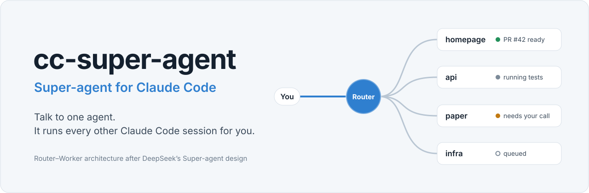
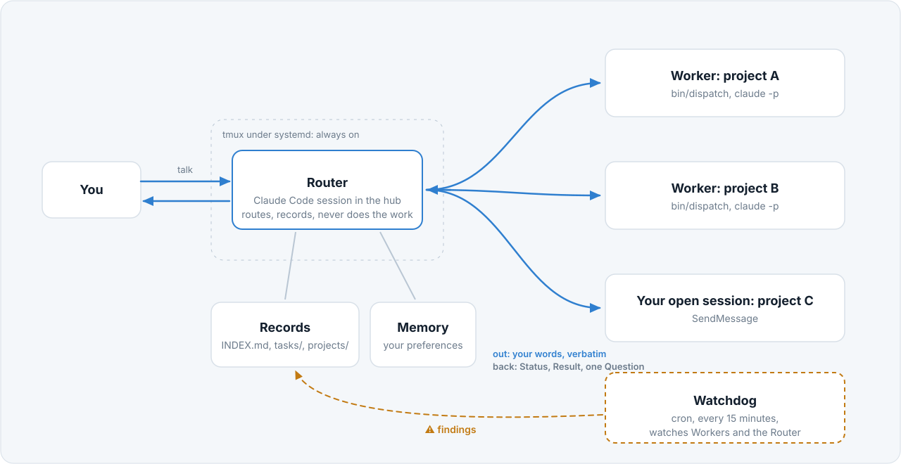
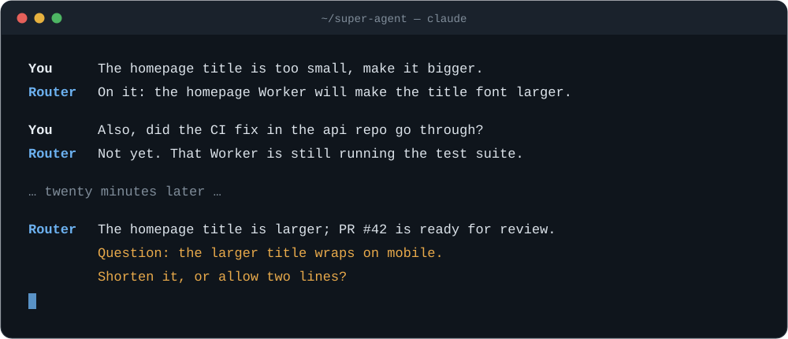
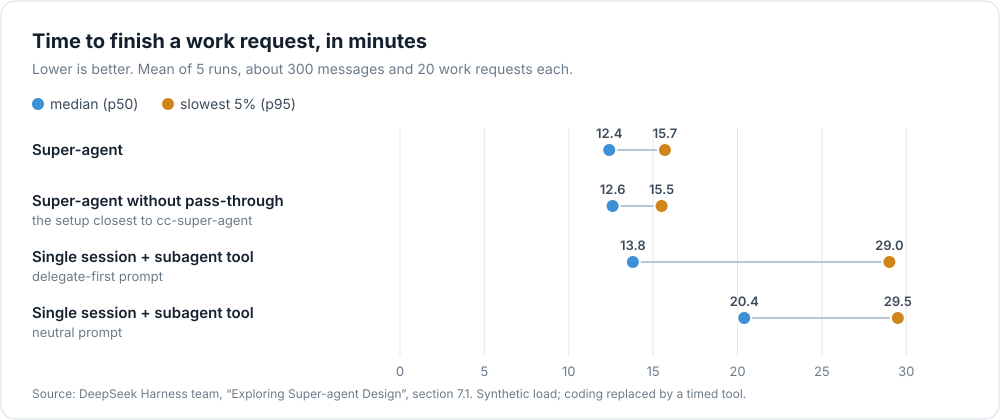

<div align="center">

<picture>
  <source media="(prefers-color-scheme: dark)" srcset="assets/hero-dark.svg">
  
</picture>

[](LICENSE)
[](https://claude.com/claude-code)
[](#工作原理)
[](#路线图)

[English](README.md) | 简体中文

</div>

---

假设你手上有五个项目，同时开着五个 Claude Code 会话。你在标签页之间来回切换，往上翻记录回想每个会话做到了哪一步，在这个会话里点一下权限确认，又把另一个会话忘了一个小时。**瓶颈早已不在模型，而在你的注意力。**

cc-super-agent 是 DeepSeek 于 2026 年 10 月发布的 **Super-agent** 设计的开源实现，专为 **Claude Code** 打造，只用 Claude Code 自带的功能搭建：不 fork、不打补丁，也不依赖任何额外服务。

你只需要维持**一个**对话。在它背后，Router 把每项工作交给相应项目中专属的 Worker 会话，用纯 Markdown 文件记录全部进展，只在有结果可以使用、或者有只能由你做的决定时才开口。

## 使用前后对比

| | 自己管理多个会话 | 使用 cc-super-agent |
| --- | --- | --- |
| 在哪里对话 | 每个项目一个标签页 | 始终是同一个对话 |
| 谁记得每个会话在做什么 | 你自己 | Router，记录在你随时可读的 Markdown 文件里 |
| 在另一个项目里开始一项工作 | 打开终端、`cd` 进目录、重新交代一遍背景 | 一句话说清 |
| 某个会话卡在权限确认或死循环里 | 碰巧去看时才发现 | Watchdog 在 15 分钟内标记出来 |
| 合上笔记本电脑 | 一切停止 | Router 在服务器上继续运行 |
| 你会收到什么 | 每个会话的每一步 | 一个结果，或者一个问题 |

## 功能特性

- 🧭 **一个 Router，多个 Worker。** Router 从不亲自干活，因此随时都能接收你的下一句话。每项任务在各自的项目中拥有专属的 Worker 会话，并加载该项目的 `CLAUDE.md` 和记忆。
- 🗣️ **转达原话，而非摘要。** Worker 收到的是你的原话，并自己去阅读原始材料。Router 不会擅自添加任何方案。
- 🔁 **后续补充送达同一个 Worker。** 每项任务都有固定的会话 ID，所以"顺便把按钮改成蓝色"会让已经掌握上下文的那个 Worker 继续工作。Worker 忙碌时收到的补充会进入队列，不会丢失。
- 🐕 **独立于系统之外的 Watchdog。** 一个由 cron 驱动的独立进程，负责发现进程已死、长时间无动静、陷入循环、偏离方向，或者卡在无人回应的确认上的 Worker。它也同时看管 Router。
- ♾️ **常驻在线。** 在服务器上，Router 由 systemd 托管在 tmux 中运行，任何一次重启后都会恢复自己原来的会话，并根据记录接续之前的工作。
- 🧠 **看得懂的记忆。** 你的偏好存入 Claude Code 的记忆；你的工作存入一套三层的 Markdown wiki：一个索引、每项任务一个文件、每个项目一个文件。Router 顺着链接逐层读取，而不是一次性加载全部内容。
- 🛑 **始终由你掌控。** 你说"先停一下"，即使 Worker 重启也依然有效，直到你亲自放行。`bin/pause` 可以一键停下所有工作。Worker 永远不会获得你没有授予的权限。
- 🔒 **默认保护隐私。** 仓库只跟踪白名单中的框架文件。你的任务、项目、日志和记忆都不会离开你的机器。

## 工作原理

<picture>
  <source media="(prefers-color-scheme: dark)" srcset="assets/architecture-dark.svg">
  
</picture>

1. **你说一句话。** Router 判断它是新工作、对已有工作的补充，还是两者都不是。
2. **Router 先记录，后行动。** 它先写好任务文件和 `INDEX.md` 中对应的一行，用一句话确认自己的理解，然后再派发。
3. **Worker 完成工作。** 它在项目自己的目录中工作，把局部改动一路做到验证通过；一旦遇到应该由你拍板的决定，就立即停下来询问。
4. **Worker 汇报结果。** 状态为 `ready`、`blocked`、`failed` 或 `dropped` 之一，附一句话的结果和最多一个问题。Router 据此重新写一条简短的消息给你，从不原样转发原始汇报。
5. **Watchdog 每 15 分钟巡检一次**，找出已经停下却没有通知任何人的工作。

Router 遵守的规则全部写在 [AGENTS.md](AGENTS.md)（英文）中。这些规则就是整个系统：读完它，你就能确切知道这个智能体会做什么、不会做什么。

## 使用示例

以下是一段示意对话：

<p align="center"></p>

<details>
<summary>中文文字版</summary>

```text
你：     首页标题太小了，调大一点。
Router： 收到：首页的 Worker 会把标题字号调大。

你：     另外，api 仓库的 CI 修复合进去了吗？
Router： 还没有，那个 Worker 还在跑测试。

         …… 二十分钟后 ……

Router： 首页标题已经调大，PR #42 可以评审了。
         问题：标题调大后在手机上会折行。是缩短标题，还是允许显示两行？
```

</details>

## 快速开始

**运行要求：** Linux 系统，装有 bash，以及 util-linux 中的 `flock` 和 `uuidgen`；已登录的 Claude Code 命令行工具（已在 2.1.316 版本上测试）。使用 Watchdog 需要 cron；让 Router 常驻在线需要 tmux、systemd 和 root 权限。

```sh
git clone https://github.com/yingpengma/cc-super-agent.git ~/super-agent
cd ~/super-agent
claude            # 从现在起，这就是你的 Router
```

这样就可以开始使用了。下面两个可选步骤能让它自主运转：

```sh
watchdog/install.sh                    # 每 15 分钟运行一次 Watchdog 巡检
sudo router/install.sh                 # 由 systemd 托管，让 Router 持续运行
tmux -L ccsa attach -t ccsa-router     # 与它对话；按 Ctrl-b 再按 d 即可离开
```

安装 Router 服务之前，请先关闭本目录中其他的 Claude Code 会话。

## 目录结构

| 路径 | 内容 |
| --- | --- |
| [`AGENTS.md`](AGENTS.md) | Router 遵守的规则，由 `CLAUDE.md` 加载 |
| [`templates/brief.md`](templates/brief.md) | 每份派给 Worker 的任务说明都从这个模板出发 |
| [`bin/dispatch`](bin/dispatch) | 启动或续接某项任务的 Worker，支持排队、并发上限和失败重试 |
| [`bin/pause`](bin/pause)、[`bin/resume`](bin/resume) | 暂停、恢复所有自动处理 |
| [`watchdog/`](watchdog) | Watchdog 的指令、运行脚本和定时任务安装脚本 |
| [`router/`](router) | 让 Router 保持运行的脚本 |

运行时生成、永不提交的内容：`INDEX.md`、`tasks/`、`projects/`、`.runs/`、`.watchdog/`、`.router/`。

## 设计来源

本项目的架构依据 DeepSeek Harness 团队的文章[《Super-agent 设计探索：迈向更自主的 Agent 系统》](https://mp.weixin.qq.com/s/zoS7GlReWPhfCjENGxXCdg)，以及他们的参考实现 [deepseek-ai/dsh-superagent-prototype](https://github.com/deepseek-ai/dsh-superagent-prototype)。在他们的实验中，处理并发工作时，双层 Router–Worker 系统比"单会话 + subagent 工具"完成得更快、更稳定（p95 分别为 15.7 分钟和 29.5 分钟），原因是单会话往往倾向于亲自干活，结果不断被新消息打断。

本项目的设计所依据的实验结果：

<p align="center">
<picture>
  <source media="(prefers-color-scheme: dark)" srcset="assets/benchmark-dark.svg">
  
</picture>
</p>

cc-super-agent 没有直通机制，因此最接近的是第二行：完成时间基本相同，只是 Router 要多做一些判断。

他们的各个模块在 Claude Code 中的对应关系：

| Super-agent 模块 | 在 cc-super-agent 中 |
| --- | --- |
| 双层架构：Router 与 Worker | ✅ 本目录的会话负责路由，各项目目录中的 `claude -p` 会话负责干活 |
| 全双工交互 | ✅ Worker 作为后台命令运行，Router 照常对话 |
| 链式召回 | ✅ 一套互相链接的 Markdown wiki，逐层读取 |
| 计算与状态分离 | ✅ 所有状态都存在磁盘上，Router 任何一次重启后都恢复它固定的会话 |
| Watchdog | ✅ 一个由 cron 驱动、独立巡检 Worker 和 Router 的进程 |
| 事件驱动 | 🚧 尚未实现：目前要你开口才开始工作 |
| 远程执行环境 | 🚧 尚未实现：Worker 目前在同一台机器上运行 |

cc-super-agent 是独立项目，与 DeepSeek 及 Anthropic 均无隶属关系。

## 路线图

- [ ] 接入事件源，让 Router 不等你开口就能发现该做的工作
- [ ] 支持在其他机器上运行 Worker
- [ ] 为派发脚本和 Watchdog 脚本添加自动化测试

欢迎提出想法和 issue。

## 常见问题

**这个项目会修改 Claude Code 吗？**
不会。它用到的 `claude -p`、`--session-id`、`--resume`、`SendMessage`，以及 cron、tmux 和 systemd，全都是原装功能。

**Worker 会以更高的权限运行吗？**
不会。每个 Worker 都使用你本人在该项目中的 Claude Code 设置。本项目从不额外授予权限，也从不把在一个会话里被拒绝的工作转交给另一个会话去做。

**它会不停地打扰我吗？**
设计上不会。Router 只在有结果、需要你做决定或者工作失败时才开口，每次只问一个问题，每项新任务只用一句话确认。

**我的数据会被提交到仓库里吗？**
不会。`.gitignore` 是一份框架文件的白名单，其余所有内容，包括你的任务、项目和日志，都只保存在本地。

## 卸载

```sh
watchdog/install.sh --remove
sudo router/install.sh --remove
```

## 引用

如果你使用了本项目，请引用：

```bibtex
@software{cc_super_agent_2026,
  author = {Ma, Yingpeng},
  title  = {cc-super-agent: Super-agent for Claude Code},
  year   = {2026},
  url    = {https://github.com/yingpengma/cc-super-agent}
}
```

GitHub 也会读取 [CITATION.cff](CITATION.cff)。

## 许可证

[MIT](LICENSE)
